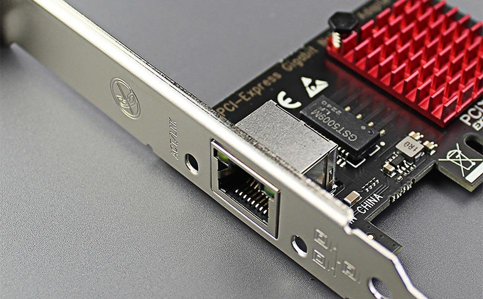
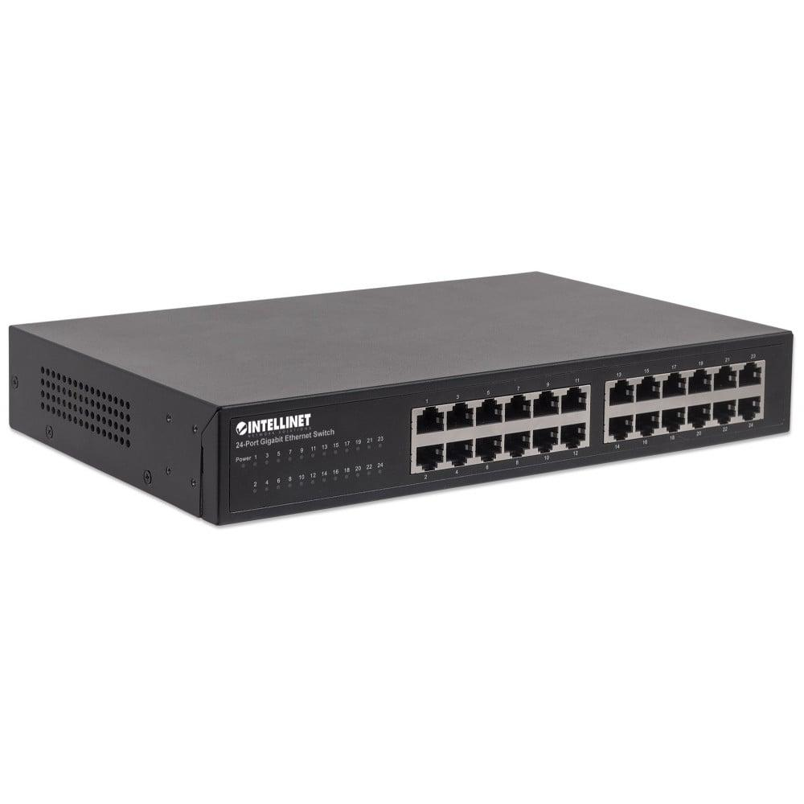
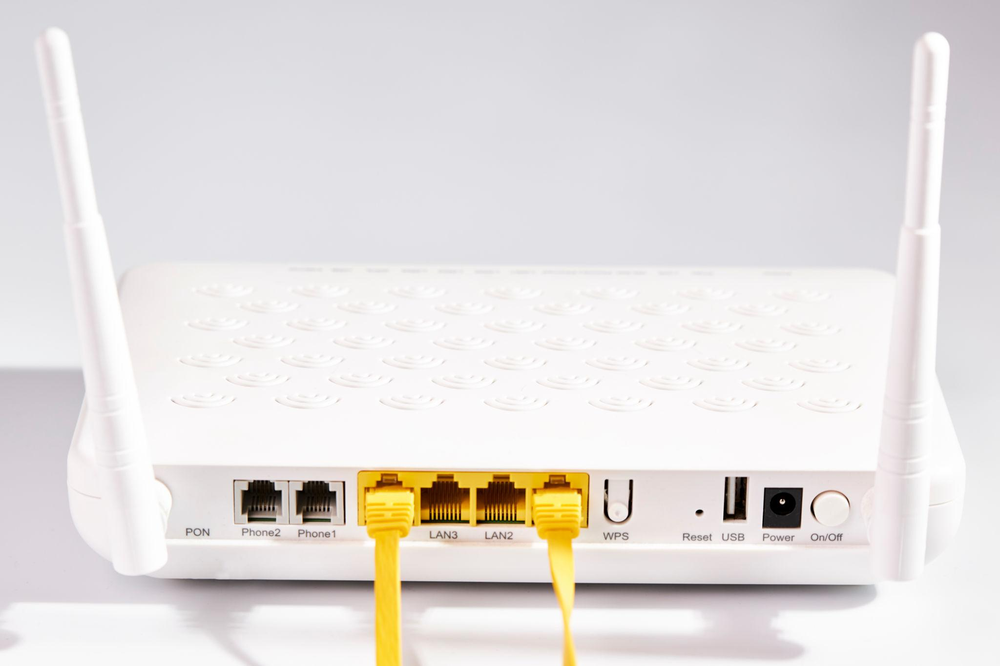
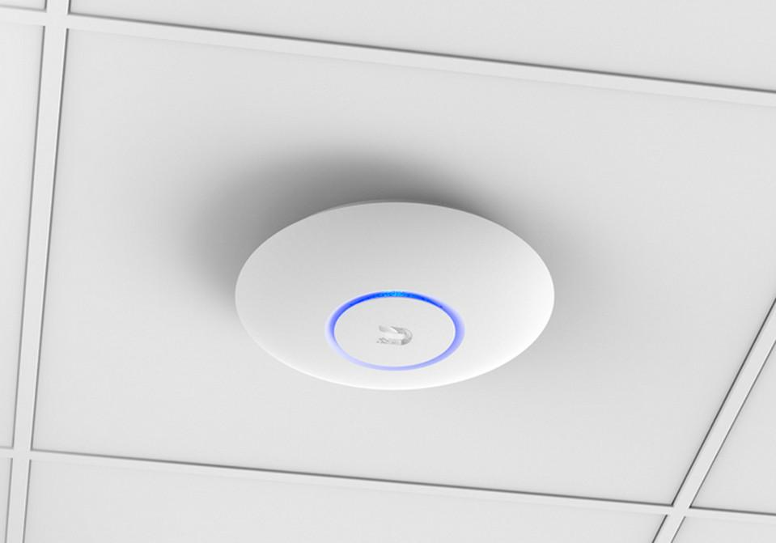

# Dispositivos de red

## 1. ¿Qué dispositivos encontramos en una red?
En una red domestica, existen multitud de dispositivos conectados a la red, como por ejemplo un ordenador, un móvil, una TV o una consola. Estos pueden estar conectados mediante Wi-Fi o cable.

## 2. Los principales dispositivos de red

### 2.1. Tarjeta de red (NIC)

NIC significa  *_Netwok Interface Card_*

La tarjeta de red es el encargado de permitir que un dispositivo se conecte a una red.

Puede ser:

- Ethernet: conexión mediante cable.
- Wi-Fi: conexión inálambrica.

**Ejemplo:** un ordenador tiene una tarjeta de red que le permite conectarse al router mediante Wi-Fi o Ethernet.

**Relación con la ciberseguridad:** permite identificar interfaces de red, direcciones MAC y direciones IP.

### 2.2.  Switch (conmutador)

Un switch permite conectar varios dispositivos dentro de una misma red local (LAN).

Por ejemplo, en una oficina se puede conectar:
- 10 ordenadores.
- 2 impresoras.
- Varios servidores.
- Otros dispositivos de red.

El switch recibe los datos y los envía al dispositivo correspondiente utilizando las direcciones MAC.

**Ejemplo:** imagina una oficina con 10 ordenadores. En lugar de conectarse todos directamente al router, podemos conectarnos a un switch.

**Relación con la ciberseguridad:** un switch mal configurado puede facilitar accesos no autorizados o ataques dentro de la red local. Más adelante veremos VLAN y segmentación de redes.

### 2.3. Router (enrutador)

El router conecta diferentes redes y dirige los paquetes de datos hacia su destino.

Por ejemplo:
- Conecta tu red doméstica con Internet.
- Permite que tus dispositivos se comuniquen con redes externas.
- Utiliza direcciones IP para decidir por dónde enviar los datos.

**Ejemplo:** cuando tu ordenador visita Google, el router permite que la comunicación salga de tu red doméstica hacia Internet.

**Relación con la ciberseguridad:** un router mal configurado puede permitir accesos externos no autorizados. Es importante proteger su administración y actualizar su firmware.

### 2.4. Punto de acceso (Access Point o AP)

